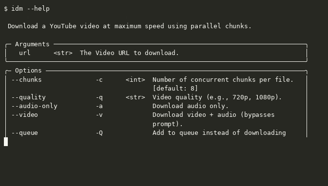

<div align="center">

<h1>IDM-CLI</h1>

**A lightning-fast, universal command-line download manager written in Python.**

[](https://pypi.org/project/idm-cli/)
[](https://pepy.tech/project/idm-cli)
[](https://sonarcloud.io/project/overview?id=rj41-w2_idm-cli)
[](https://github.com/rj41-w2/idm-cli/pulls)
[](https://github.com/rj41-w2/idm-cli/blob/main/LICENSE)

[](https://pypi.org/project/idm-cli/)

[Website](https://rj41-w2.github.io/idm-cli/) · [Download via PyPI](https://pypi.org/project/idm-cli/) · [Report a Bug](https://github.com/rj41-w2/idm-cli/issues)

</div>

**IDM-CLI** (short for *Internet Download Manager CLI*) is a free, open-source
download manager for the terminal — an `idm` command you run from your shell.
It splits files into multiple parallel chunks (default 8, up to 32) to saturate
your bandwidth, resumes interrupted downloads from the exact byte it stopped at,
and downloads video and audio from **YouTube**, **Facebook**, **Instagram**, and
any **direct file URL** (`.exe`, `.zip`, `.pdf`, `.iso`, `.mp4`, …).

If you are looking for a command-line Internet Download Manager — an IDM-style
accelerated downloader for Linux, macOS, or Windows that lives in the terminal
instead of the desktop — this is it. Think of it as an `aria2` or `wget`
alternative with a friendlier interactive UI and built-in media extraction.

> Install: `pip install idm-cli` · Run: `idm "<url>"`



## Features

- **Parallel Chunk Engine** — Splits downloads into multiple concurrent chunks using `curl-cffi` async sessions to fully saturate your bandwidth.
- **Universal Downloader** — Paste any URL. yt-dlp handles 1000+ sites (YouTube, Facebook, Instagram, etc.), with automatic fallback to direct HTTP download for unsupported URLs.
- **Audio Only / MP3 Conversion** — Download videos as audio. IDM-CLI automatically grabs the best audio stream and uses FFmpeg to convert it to `.mp3`.
- **Smart Auto-Resume** — Internet dropped? Pressed `Ctrl+C`? No problem. IDM-CLI remembers the exact byte positions of all incomplete chunks. Paste the same link again to resume instantly.
- **Persistent Queue System** — Add multiple files to a queue with `-Q` and type `start queue` to download them all sequentially.
- **Interactive UI** — Modern terminal interface powered by `rich` and `questionary` with real-time speed, ETA, and progress bars. Press `p` to pause, `r` to resume.
- **Cross-Platform** — Works on Windows, macOS, and Linux with platform-specific FFmpeg handling.
- **Auto-Update Check** — Checks PyPI once a day and notifies you when a new version is available.

## Security

**IDM-CLI is a download manager, not an antivirus.** It does not scan files for
malware — no signature database, no heuristic engine. Downloading a file that
contains malware will not trigger any warning from IDM-CLI itself.

What IDM-CLI does give you:

- **SSRF protection** — URLs pointing at private/loopback/link-local hosts
  (`localhost`, `127.0.0.1`, `10.x`, `192.168.x`, `169.254.169.254`, …) are
  rejected, so a crafted link cannot make IDM-CLI probe your internal network.
- **No shell execution** — all `subprocess` calls use `shell=False` with
  argument lists; no URL or title ever reaches a shell.
- **Verified FFmpeg download** — when IDM-CLI auto-installs FFmpeg, the archive
  is checked against the SHA-256 digest published by GitHub Releases.

**How to stay safe:** rely on your operating system's antivirus, which scans
files as they land on disk.

- **Windows:** Windows Defender real-time protection scans WSL paths
  (`\\wsl.localhost\...`) automatically — nothing to configure.
- **Linux:** install ClamAV (`sudo apt install clamav`), keep the signature
  database current (`sudo freshclam`), and scan a download with
  `clamscan ~/Downloads/file`. Add a cron job or an inotify watcher to scan
  automatically.

This mirrors how the official Internet Download Manager behaves: IDM does not
detect malware either — it can be configured (Options → Downloads → Virus
checking) to call an installed antivirus after a download finishes, and
otherwise relies on the antivirus's real-time protection.

## Prerequisites

- **Python 3.8+**
- **FFmpeg** — Required for muxing video and audio streams, and converting to `.mp3`. IDM-CLI can auto-download it for you, or you can install it manually:
  - Windows: `winget install ffmpeg`
  - macOS: `brew install ffmpeg`
  - Linux: `sudo apt install ffmpeg`

## Installation

```bash
# From PyPI
pip install idm-cli

# From source
git clone https://github.com/rj41-w2/idm-cli.git
cd idm-cli
pip install -e ".[dev]"
```

## Usage

Run the app interactively:

```bash
idm
```

This opens a prompt where you can paste your link, select video quality, or queue the download.

### CLI Flags (Fast Mode)

Skip the interactive menus by passing arguments directly:

```bash
# Download a video at 1080p
idm "https://youtube.com/watch?v=..." -q 1080p -v

# Audio only (converts to MP3)
idm "https://youtube.com/watch?v=..." -a

# 16 parallel chunks for maximum speed
idm "https://example.com/largefile.zip" -c 16

# Add to queue
idm "https://facebook.com/..." -Q
```

| Flag | Description |
|------|-------------|
| `-q <resolution>` | Set video quality (e.g., `1080p`, `720p`) |
| `-a` | Audio only — download and convert to MP3 |
| `-v` | Download video + audio (bypasses quality prompt) |
| `-Q` | Add to queue instead of downloading immediately |
| `-c <num>` | Number of parallel chunks (default: 8) |
| `-f <filename>` | Force a custom output filename |

### Interactive Commands

| Command | Description |
|---------|-------------|
| `<URL>` | Download a video or file |
| `resume` | Resume or delete incomplete downloads |
| `start queue` | Process all queued downloads |
| `help` | Show available commands and flags |
| `exit` | Exit the application |

### Troubleshooting: Windows Device Guard

If you get `"idm.exe was blocked by your organization's Device Guard policy"`, run the Python module directly:

```bash
python -m idm_cli
```

## Architecture

```
idm_cli/
├── __init__.py              # Package version
├── __main__.py              # python -m idm_cli entry point
├── config.py                # Platform-aware config, logging, and paths
├── update_checker.py        # PyPI version check
├── ui/
│   ├── cli.py               # Typer entry point and interactive command loop
│   ├── prompts.py           # Questionary prompts and user-facing messages
│   ├── progress.py          # Rich progress display and pause/resume controls
│   └── utils.py             # URL validation, filename safety, and terminal helpers
├── downloader/
│   ├── core.py              # Download orchestration and destination management
│   ├── downloader.py        # Async ranged downloads, retries, and resume validation
│   ├── handlers.py          # Queue & resume handlers
│   ├── muxer.py             # FFmpeg verification, muxing, and conversion
│   └── state.py             # Locked, atomic JSON state persistence
└── extractors/
    ├── __init__.py          # Direct HTTP probe and extractor selection
    ├── ytdlp.py             # YouTube/social media extractor
    ├── direct.py            # Direct HTTP file metadata and URL extraction
    └── winget.py            # Windows Package Manager metadata extraction

tests/                       # pytest suite (runs fully offline)
```

The download flow is: `core.py` selects the extractor and prepares the
destination and media pipeline, `downloader.py` downloads validated byte ranges,
`progress.py` renders live progress, and `muxer.py` creates the final media file.
Interrupted downloads are tracked under the platform-specific application data
directory, not inside the repository.

## Contributing

Contributions are welcome. Fork the repo, make your changes on a feature branch, and open a PR against `main`. Keep changes focused and follow the existing code style.

For bug reports and feature requests, [open an issue](https://github.com/rj41-w2/idm-cli/issues).

## License

This project is licensed under the [MIT License](LICENSE).
